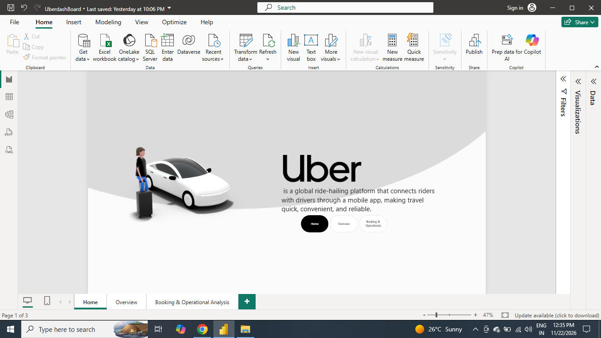
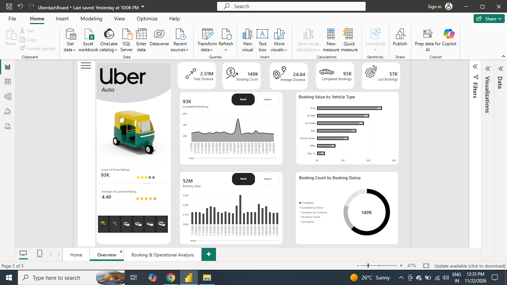
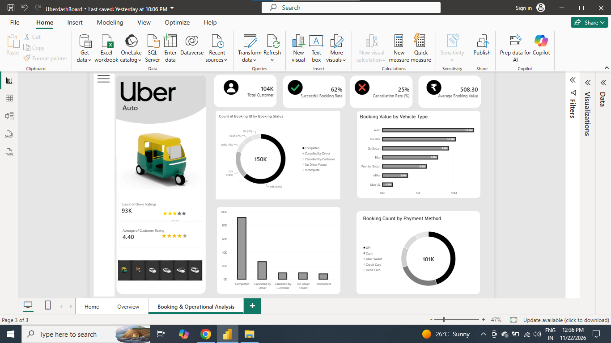

# 🚗 Uber Ride Analytics Dashboard (Power BI)

An interactive Power BI dashboard that analyzes ~150K Uber bookings to uncover trends in ride demand, booking value, vehicle performance, cancellations, and payment behavior.



## 📌 Overview

The report has three pages:

| Page | What it shows |
|------|---------------|
| **Home** | Landing page with an introduction and navigation buttons |
| **Overview** | Ride volume, distance, completed vs. lost bookings, booking value trends, and vehicle-type performance |
| **Booking & Operational Analysis** | Customer metrics, success and cancellation rates, booking status breakdown, and payment methods |


## 📸 Screenshots

### Overview


### Booking & Operational Analysis


## ✨ Features

- **KPI cards:** total distance, booking count, average distance, completed bookings, lost bookings, total customers, successful booking rate, cancellation rate, and average booking value
- **Time trends:** completed bookings and booking value over time, with a Month / Quarter toggle
- **Vehicle analysis:** booking value by vehicle type (Auto, Go Mini, Go Sedan, Bike, Premier Sedan, eBike, Uber XL)
- **Booking status breakdown:** Completed, Cancelled by Driver, Cancelled by Customer, No Driver Found, Incomplete
- **Payment mix:** UPI, Cash, Uber Wallet, Credit Card, Debit Card
- **Ratings:** driver rating count and average customer rating
- **Page navigation:** custom buttons and a vehicle selector panel

## 🔍 Key Insights

- **62%** of bookings were completed (93K of 150K), while **25%** were cancelled.
- **Driver cancellations (18%)** are the biggest cause of lost bookings, far more than customer cancellations (7%).
- **Auto** generates the highest booking value (₹12.9M), followed by Go Mini (₹10.3M) and Go Sedan (₹9.4M). **Uber XL** is the lowest (₹1.5M).
- Total booking value is about **₹52M**, with an average booking value of **₹508.30**.
- The average customer rating is **4.40 / 5**.
- Daily completed bookings stay fairly steady with one clear demand spike around the third week of the period.

## 🛠️ Tech Stack

| Area | Tools |
|------|-------|
| Visualization | Microsoft Power BI Desktop |
| Data modeling | Power Query, DAX |
| Data source | Uber ride bookings dataset (CSV) |

## 📂 Project Structure

```
uber-dashboard/
├── data/                  # Raw dataset (CSV)
├── images/                # Dashboard screenshots
├── UberdashBoard.pbix     # Power BI report file
└── README.md
```

## 📊 Dataset

- **Source:** [Dataset-20261030T113959Z-1-001.zip](#)
- **Size:** ~150K bookings
- **Key fields:** booking date, booking status, vehicle type, ride distance, booking value, payment method, driver rating, customer rating

## 🧮 DAX Measures

Example measures :

```DAX
Average Booking Value = 
AVERAGE(Uber[Booking Value])
Average Distance = AVERAGE(Uber[Ride Distance])
Booking Count = DISTINCTCOUNT(Uber[Booking ID])
Booking_Value = SUM(Uber[Booking Value])
Cancellation Rate (%) = 
DIVIDE(
    CALCULATE(
        COUNTROWS(Uber),
        Uber[Booking Status] IN {
            "Cancelled by Driver",
            "Cancelled by Customer"
        }
    ),
    COUNTROWS(Uber),
    0
)
Completed Bookings = CALCULATE([Booking Count], Uber[Booking Status]="Completed")
Lost Bookings = CALCULATE([Booking Count], Uber[Booking Status]<>"Completed")
Successful Booking Rate = 
DIVIDE(
    CALCULATE(
        COUNTROWS(Uber),
        Uber[Booking Status] = "Completed"
    ),
    COUNTROWS(Uber),
    0
)
Total Customer = DISTINCTCOUNT(Uber[Customer ID])
Total Distance = SUM(Uber[Ride Distance])
```

## 🚀 Getting Started

### Prerequisites
- [Power BI Desktop](https://powerbi.microsoft.com/desktop/) (free, Windows only)

### Open the dashboard

1. Clone this repository:
   ```bash
   git clone https://github.com/Laxmi1110/UberDashboard.git
   cd UberDashboard
   ```
2. Open `UberdashBoard.pbix` in Power BI Desktop.
3. If prompted, update the data source path: **Home > Transform data > Data source settings**, then point it to the CSV in the `data/` folder.
4. Click **Refresh** to load the data.

## 🔮 Future Improvements

- Add a map visual for pickup and drop-off hotspots
- Add demand forecasting
- Connect to a live data source for automatic refresh
- Add driver-level performance analysis


## 📬 Contact

**Laxmi Gupta** · [[LinkedIn](https://www.linkedin.com/in/laxmigupta188777/)] · laxmigupta188777@gmail.com.com
